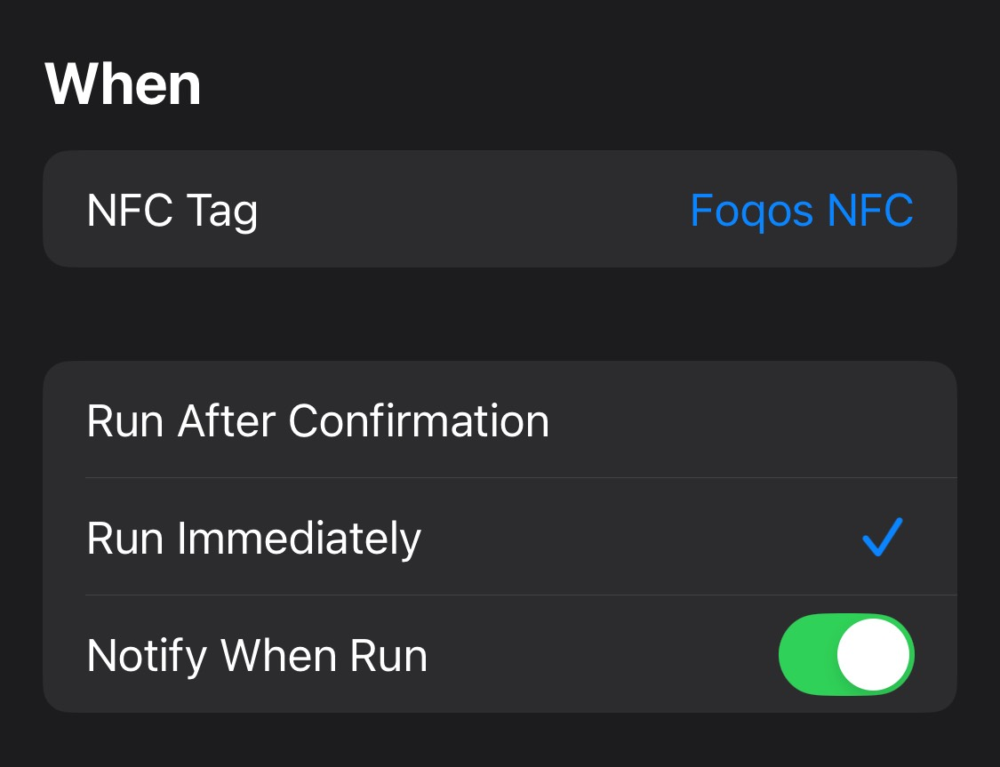
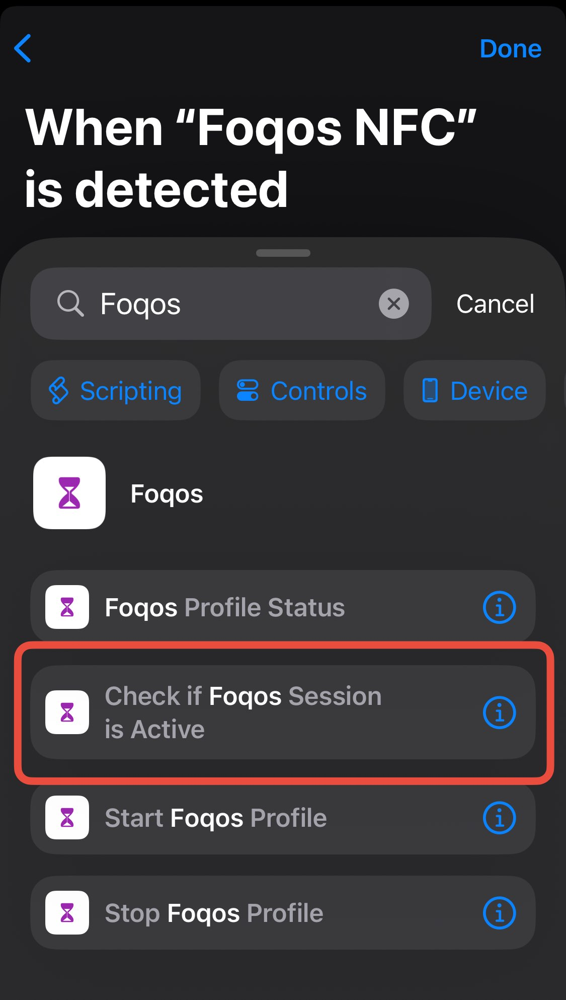
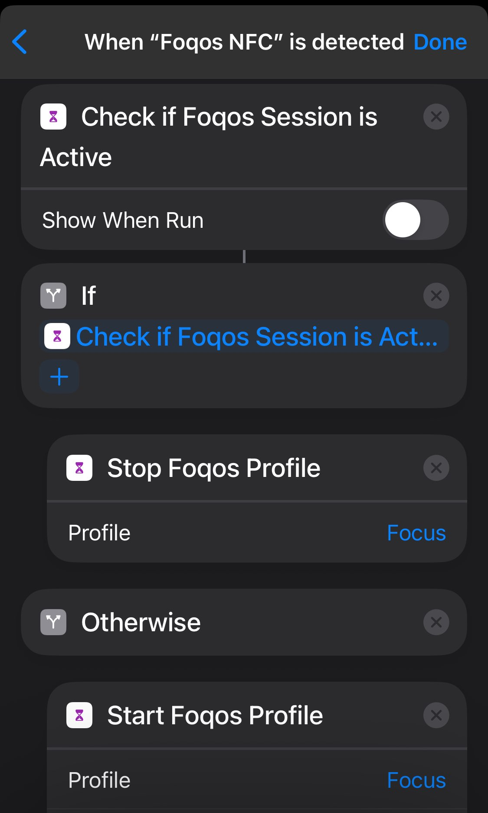
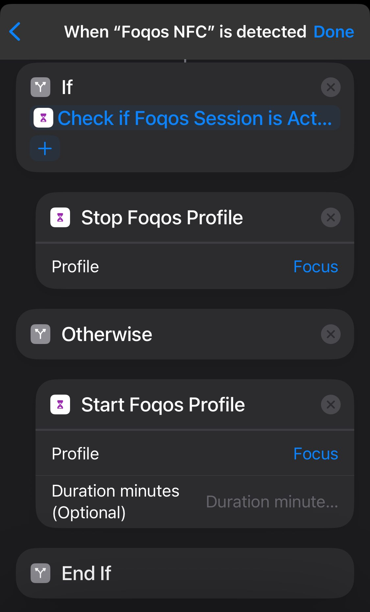

# LockedIn

**An iPhone app blocker with NFC and QR code unlocking.**

LockedIn uses Apple's Screen Time API to block distracting apps and websites. Start a focus
session manually, with an NFC tag, with a QR code or barcode, with a timer, or with temporary
access rules. Data stays on your device: no account, no tracking, no ads.

## Features

- App and website blocking through Apple's Screen Time APIs
- Custom profiles for different routines, schedules, app groups, and domains
- NFC tag blocking for physical start and stop flows
- QR code and barcode blocking, including generated profile QR codes
- Timer-based sessions that end automatically after a chosen duration
- Optional reusable break allowance that can be split across multiple breaks in a session
- Physical unlock rules for profiles that should only stop with approved tags or codes
- Temporary Access strategies for limited, short opens without ending the full session
- Pause Timer strategies for a short pause before blocking resumes
- Smart breaks, session history, focus streaks, and profile insights
- Live Activities for Lock Screen and Dynamic Island status
- Widgets and App Intents for faster profile control
- Local-first privacy with no cloud sync or analytics

## Blocking Strategies

LockedIn includes several ways to start and stop a blocking session. All strategies are implemented in `Foqos/Models/Strategies/` and registered in `Foqos/Utils/StrategyManager.swift`.

| Strategy | Best for | How it works |
| --- | --- | --- |
| `ManualBlockingStrategy` | Simple in-app blocking | Start and stop directly in LockedIn. |
| `NFCBlockingStrategy` | Physical NFC app blocking | Scan an NFC tag to start. Scan the same tag again to stop, unless strict unlock rules are configured. |
| `QRCodeBlockingStrategy` | QR code or barcode blocking | Scan a QR code or barcode to start. Scan the same code again to stop, unless strict unlock rules are configured. |
| `NFCManualBlockingStrategy` | Easy start, physical stop | Start in the app. Stop by scanning an NFC tag. |
| `QRManualBlockingStrategy` | Easy start, QR or barcode stop | Start in the app. Stop by scanning a QR code or barcode. |
| `NFCTimerBlockingStrategy` | Timed focus with NFC escape hatch | Choose a duration. Blocking ends when the timer expires, or early when an allowed NFC tag is scanned. |
| `QRTimerBlockingStrategy` | Timed focus with QR or barcode escape hatch | Choose a duration. Blocking ends when the timer expires, or early when an allowed QR code or barcode is scanned. |
| `ShortcutTimerBlockingStrategy` | Manual timer sessions | Choose a duration. Stop early with the in-app Stop button. |
| `NFCPauseTimerBlockingStrategy` | Long sessions with NFC pause control | Choose a pause duration. Scan an NFC tag once to pause, then again during the pause to fully stop. |
| `QRPauseTimerBlockingStrategy` | Long sessions with QR or barcode pause control | Choose a pause duration. Scan a QR code or barcode once to pause, then again during the pause to fully stop. |
| `NFCSoftUnblockBlockingStrategy` | Limited temporary access with NFC stop | Keep blocking active but allow a configured number of short opens. Stop the session with an NFC tag. |
| `QRSoftUnblockBlockingStrategy` | Limited temporary access with QR or barcode stop | Keep blocking active but allow a configured number of short opens. Stop the session with a QR code or barcode. |

Strict unlocks can require specific physical unlock items. When a profile has an approved NFC tag, QR code, or barcode configured, other tags and codes cannot stop that profile.

## Requirements

- iOS 17.6+
- iPhone with NFC capability for NFC strategies
- Screen Time permissions for app and website blocking
- Apple Developer account with the required Screen Time and NFC entitlements for local development

## NFC Tags and QR Codes

LockedIn works with common NFC tags such as NTAG213. You can write profile links to NFC tags from inside the app, then place tags where they match the routine: desk, bedside table, gym bag, office door, or another physical location.

QR codes are free to print or display on another device. Each profile can expose a deep link in this format:

```text
https://shen.sh/profile/<PROFILE_UUID>
```

The same routes also open through the custom scheme, for example `lockedin://profile/<PROFILE_UUID>`.

Universal links need `https://shen.sh/.well-known/apple-app-site-association` to list the app's
`<TEAM_ID>.<BUNDLE_ID>`. NFC tags written by upstream Foqos (`https://foqos.app/profile/...`) are
still read, but they only open LockedIn when scanned from inside the app.

Scanning a QR code with that link can toggle the profile. If the profile is inactive, LockedIn starts it. If it is active, LockedIn stops it when the profile's strategy and unlock rules allow that stop.

## Siri

Open LockedIn once after installing or updating it, then ask Siri to control your sessions.
For a profile named "Work", try:

- "Start Work in LockedIn"
- "Start a profile in LockedIn" (Siri asks which profile)
- "Stop my session in LockedIn"
- "Pause my session in LockedIn"
- "Start a break in LockedIn"
- "End my break in LockedIn"
- "Is my session active in LockedIn"
- "What profile is active in LockedIn"

Replace "Work" with your profile's name. These commands are available automatically—no shortcut
setup is needed. Enable breaks in your profile to use the break commands, or choose a Pause Timer
strategy to use the pause command.

## iOS Shortcuts Setup

You can trigger LockedIn profiles through iOS Shortcuts. For NFC automations, create one automation per NFC tag.

1. Open the Shortcuts app and go to the Automation tab.
2. Tap Create Personal Automation and choose NFC.
3. Scan the NFC tag and name it for the LockedIn profile you want to run.
4. Enable Run Immediately and turn on Notify When Run.



5. Add a blank automation, search for LockedIn, and add Check if LockedIn Session is Active. Turn off Show When Run.



6. Add an If block with Start LockedIn Profile and Stop LockedIn Profile. For both actions, select the target LockedIn profile.
7. Arrange the actions so the profile stops if active and starts if inactive.




## Development

### Prerequisites

- Xcode 15.0+
- iOS 17.0+ SDK
- Swift 5.9+
- Apple Developer account with Screen Time and NFC entitlements

### Build Commands

```bash
make build      # Build the project
make lint       # Check Swift formatting
make lint-fix   # Fix Swift formatting
make check      # Run lint and build
make clean      # Clean build artifacts
make help       # Show all commands
```

Or open the project in Xcode:

```bash
git clone https://github.com/rt-wang/lockedin.git
cd lockedin
open foqos.xcodeproj
```

Signing uses team `67K94N9B2N`. Bundle identifiers start with `sh.shen.lockedin` and the app group
is `group.sh.shen.lockedin`. Xcode targets, schemes and folder names still use the upstream
`foqos` names.

### Releases

`make app-release` and `make mac-release` come from upstream. Before running `make mac-release`:

- create a Developer ID Application certificate for team `67K94N9B2N`, and Developer ID
  provisioning profiles named `LockedIn Mac Developer ID` (`sh.shen.lockedin.mac`) and
  `LockedIn Filter Developer ID` (`sh.shen.lockedin.mac.filter`)
- store notary credentials as `lockedin-notary` (`xcrun notarytool store-credentials`)
- generate a Sparkle key under the account `lockedin`
- set `GITHUB_REPOSITORY`

The Mac app has no update feed configured yet (see the TODO in `FoqosMac/Info.plist`).

### Project Structure

```text
foqos/
|-- Foqos/                     # Main app target
|   |-- Views/                 # SwiftUI views
|   |-- Models/                # SwiftData models and blocking strategies
|   |-- Components/            # Reusable UI components
|   |-- Utils/                 # Utility functions and managers
|   `-- Intents/               # App Intents and Shortcuts
|-- FoqosWidget/               # Widget and Live Activity extension
|-- FoqosDeviceMonitor/        # Device Activity monitor extension
|-- FoqosShieldAction/         # Managed Settings shield action extension
`-- FoqosShieldConfig/         # Managed Settings shield configuration extension
```

### Technologies

- SwiftUI
- SwiftData
- Family Controls
- Managed Settings
- Device Activity
- Core NFC
- CodeScanner
- BackgroundTasks
- ActivityKit and Live Activities
- WidgetKit
- App Intents

## License

MIT. See [LICENSE](LICENSE).

## Credits

LockedIn is a fork of [Foqos](https://github.com/awaseem/foqos) by Ali Waseem, released under the
MIT License. The original copyright notice is kept in [LICENSE](LICENSE). Thanks to the Foqos
author and contributors for the app this project is built on.
